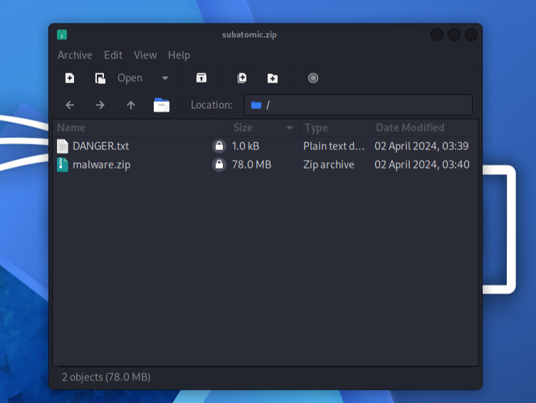
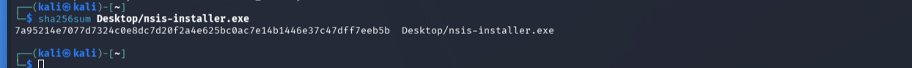
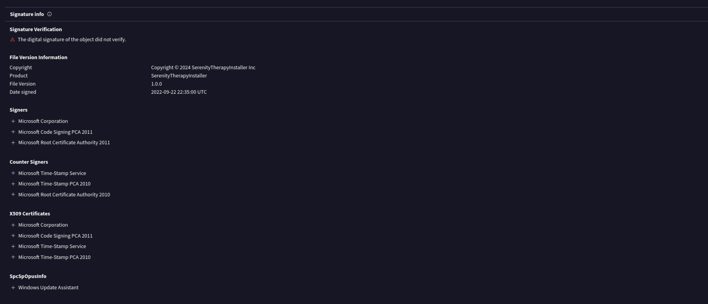
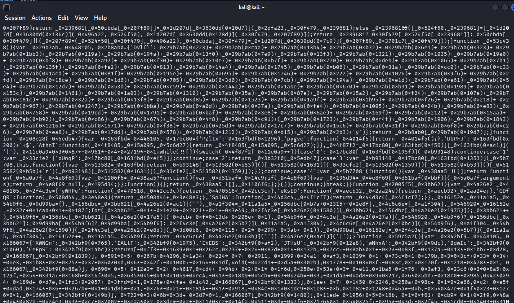
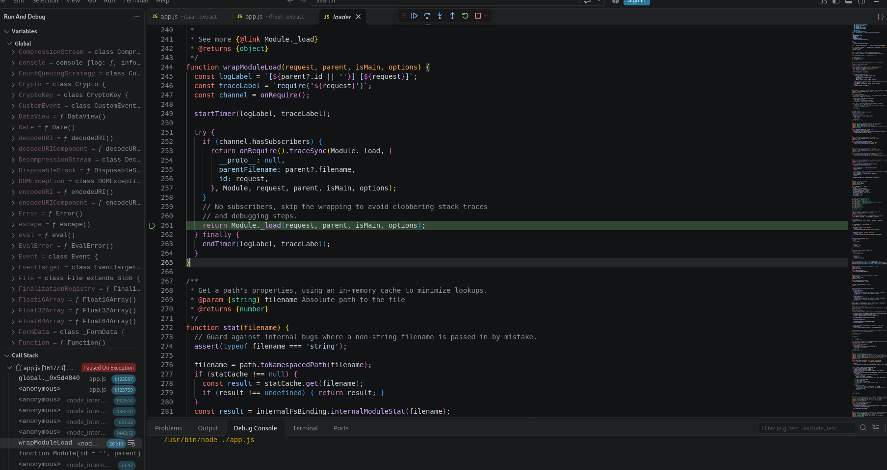

# Subatomic

  

**Subatomic** is a Hack The Box Sherlock in the **Malware Analysis** category, with overlap into **DFIR** (Digital Forensics and Incident Response) and **reverse engineering**. This project covers file metadata and signature analysis, unpacking Nullsoft (NSIS) installers, extracting Electron ASAR archives, deobfuscating JavaScript, and identifying indicators of compromise (C2 domain, GUID, infected Discord module).

## Scenario: 
Forela is in need of your assistance. They were informed by an employee that their Discord account had been used to send a message with a link to a file they suspect is malware. The message read: "Hi! I've been working on a new game I think you may be interested in it. It combines a number of games we like to play together, check it out!". The Forela user has tried to secure their Discord account, but somehow the messages keep being sent. They need your help to understand this malware and regain control of their account!

## Solution and Analysis:

  The current task at hand is to find out how the malware performs and keep sending messages through the discord account. Afterwards, we can use that knowledge to stop it and regain control of the discord account. We are presented with a zip file, and unzipping it shows 2 files, a readme from HTB and the malware zip.

  

The folder inside malware contains `nsis-installer.exe`. NSIS is a real tool for building Windows installers, and the file's type confirms this installer was built with it. The malware presents itself as a normal installer, but it packs a malicious payload.

 - Task 1 asks us to give the imphash of the .exe malware. In order to do that, I will get the SHA256 hash and then upload it at virus total. I'm gonna use sha256sum on the console, and then I can input that into virus total.

  

Here, we can see the results on virus total, and then grab the imphash from the details tab, which is  `b34f154ec913d2d2c435cbd644e91687`

  

- Task 2 asks for the program name specified in the SpcSpOpusInfo Data Structure. It also instructs that the malware has a Digital Signature. Let's view the signature section on Virus Total

  

In the lower section of the tab, we can view the program name is `Windows Update Assistant`, under the SpcSpOpusInfo data structure.

- Task 3 asks us for a unique GUID that the malware uses during installation. Since this is a NSIS binary file type, let's see the compressed installation files using zip functions in the Linux Console.
I used 7zip and found dll files and a unins inside:

Most of these are dll files but the one that grabs my attention is app-32.7z. Why would the malicious actor put another zip inside? Perhaps it's to compress the payload and increase efficiency.

Now, to find the GUID, we look for .nsi file, since Nullsoft installers usually put the instructions of the installation inside. The 7zip command did not show the file, and after some searching I found out newer versions of 7zip do not include these scripts. Therefore, I had to search the files, and in the uninstaller file, the unique GUID is `cfbc383d-9aa0-5771-9485-7b806e8442d5`. It's mentioned multiple times. The unique GUID is same to avoid installation conflicts.

After, I decided to extract the file into another folder to take a closer look at the files inside

There's more dll files and pak files, but the standalone .exe is what caught my interest. I think we should pay more attention there. But for now, let's move along with the tasks.
- Task 4 states that the malware contains a package.json file with metadata associated with it. What is the 'License' tied to this malware?

The first files I noticed with .json extension were the ones in the main folder but those were related to Vulkan and did not return useful info.
But, in the `resources` folder there's 2 files, `app.asar` and `elevate.exe` which I decided to look closer into. The asar file was large, I decided to see what's inside. Using asar and ls commands, here's the output. 

 

So, the file contains the package.json we needed, and there's also a .js file, which is also noteworthy. How and why did the malicious actor use the .js file? It could be used to activate local scripts. Let's use cat command and see the license needed for task 4, which we can identify as an `ISC` License. There's also some dependencies that are used here, I'll install them in order to analyze the program.

- Task 5 states that the malware connects back to a C2 address during execution. What is the domain used for C2? 
My first instinct is to check the .js file and unfortunately, It's obfuscated, so reading through is not an option.

 

Then, I tried to deobfuscate the code via webcrack but that was unsuccessful. So I decided to open it in VS Code. It opened the entire code in 1 line, so after using js-beautify, I was met with a 2 thousand line code.

 

This took a while, but going through the beautified code, I found a few URLs sitting in readable parts. Two of them stood out: https://ipinfo.io/json and https://illitmagnetic.site/api/. The first is a public service that just returns your IP address, so I figured the malware uses it to look up the victim’s location. The second is a domain I didn’t recognize, and with the /api/ path it looks like where the malware would send data and get instructions, which is what a C2 does. So the C2 domain is `illitmagnetic.site.` Task 6 asks for the address which gets the public domain, which is the link I mentioned earlier. Therefore, the answer to ask 6 is `https://ipinfo.io/json`.

 

At this point I found it way too difficult to debug on the Kali machine. After some searching, multiple sources suggested to open the same file on a Win11 machine, so I did. 
